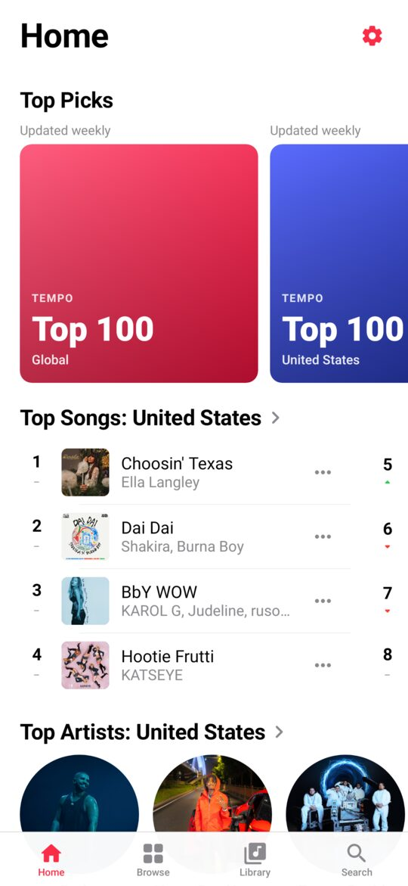
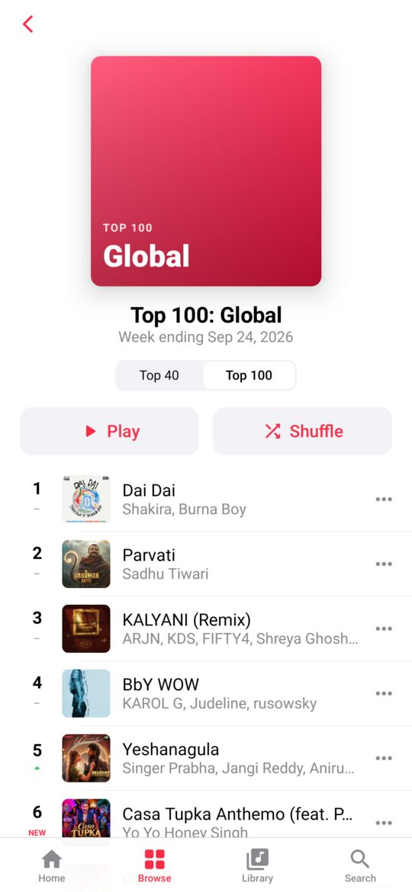
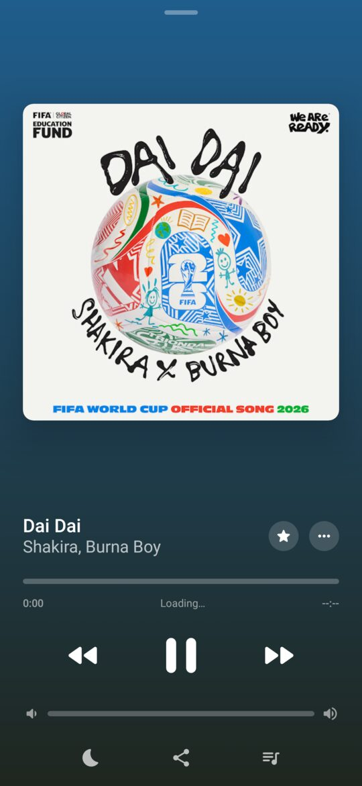
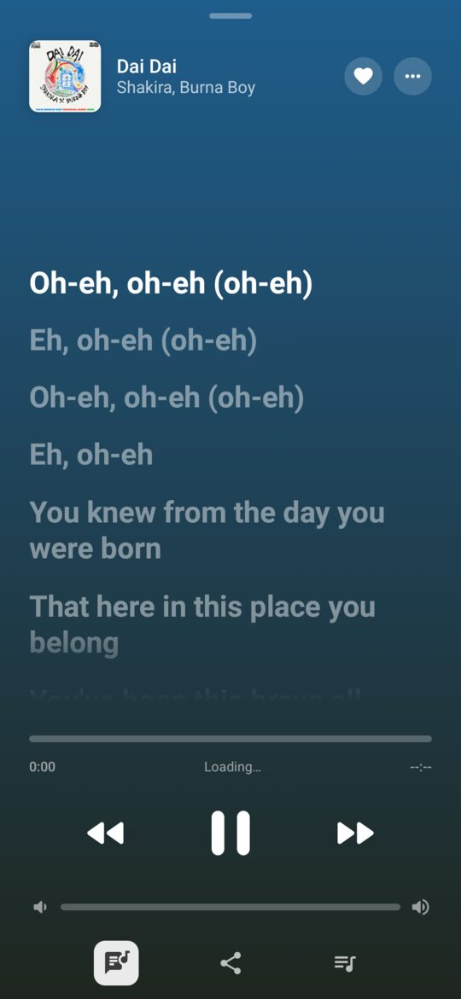
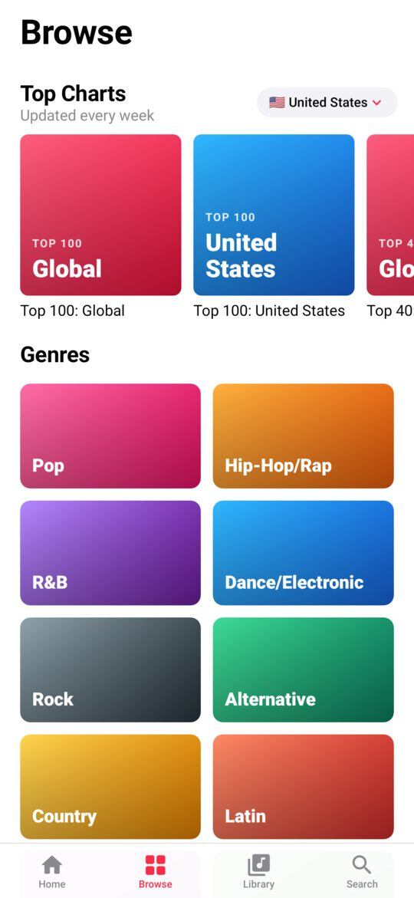
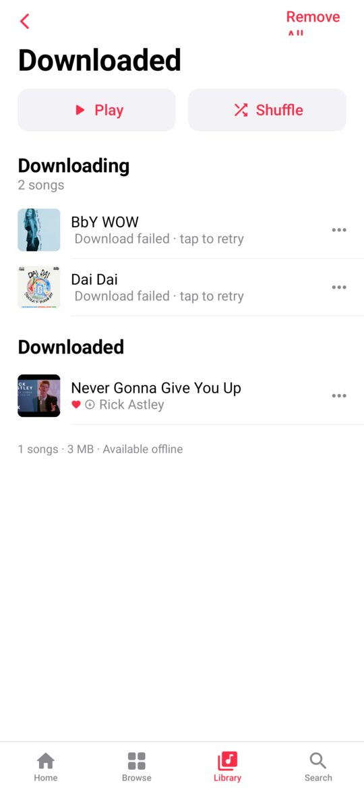
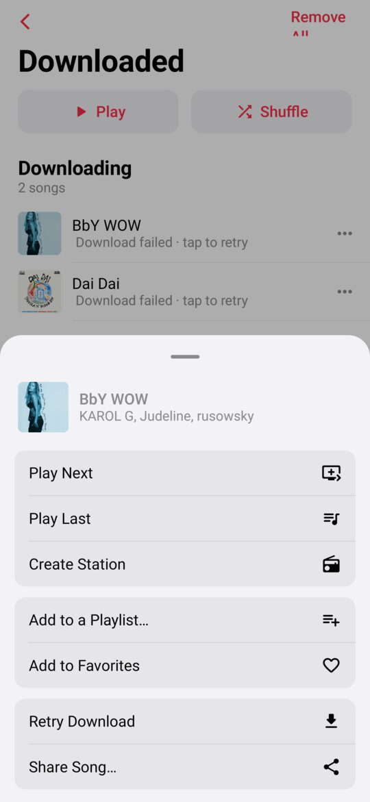
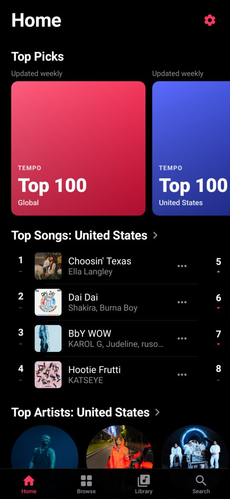

# Tempo

An Apple Music–style music player for Android that streams from YouTube.

<p>




</p>
<p>




</p>

## Features

- **Charts**: official YouTube Charts. Top 40 and Top 100 songs and top artists, for Global
  and about 60 countries. Charts update weekly and show rank movement (▲ ▼ NEW). Chart songs
  use the official audio ("art track") rather than the music video.
- **Home**: Top Picks, Recently Played, Top Songs, Top Artists, and playlist shelves that
  rotate daily.
- **Browse**: chart tiles, 16 genres and 12 moods/activities. Each has its own page with
  top songs and playlists.
- **Search**: live suggestions, recent searches, and filters for Songs, Albums, Artists and
  Playlists. Results load more as you scroll.
- **Similar songs**: "Create Station" builds a radio from any song. **Autoplay (∞)** keeps
  adding similar songs when your queue runs out.
- **Now Playing**: the background colour comes from the artwork. The artwork shrinks when
  paused. Includes a scrubber, volume, a ♥ favourite button, share, and a queue with
  shuffle, repeat, autoplay, drag-to-reorder and swipe-to-remove. The sleep timer is in the
  ⋯ menu.
- **Crossfade**: the end of each song blends into the start of the next, like Apple Music.
  On by default at 6 seconds. Turn it off or set 1–12 seconds in Settings → Playback.
  Skipping, seeking or pausing cuts straight over with no fade.
- **Equalizer**: a 10-band equalizer (31 Hz–16 kHz, ±12 dB) with 17 presets (Bass Booster,
  Vocal Booster, Rock, Late Night, …) and your own custom curve. The live curve shows what
  the filters actually do. It processes the audio inside the player, so it works the same on
  every phone. Settings → Playback → Equalizer, or ⋯ on Now Playing.
- **Lyrics**: time-synced lyrics that follow the song, with the current line highlighted.
  Tap a line to jump to it. Lyrics come from [LRCLIB](https://lrclib.net) and are saved on
  the device after the first view, so they also show offline.
- **Downloads**: save any song, album, playlist or your Favorites for offline listening.
  Downloads run in the background with a progress notification and play straight from
  storage, with no connection needed. Manage them in Library → Downloaded or in Settings.
- **Library**: your own playlists, Favorite Songs (♥), Recently Played, Downloaded, and saved
  albums, playlists and artists. All stored on the device.
- **Background playback**: lock-screen and notification controls, Bluetooth/headset
  buttons, and audio focus. Replays come from a 512 MB on-device audio cache.
- **Share a YouTube or YouTube Music link** to Tempo to play it.
- Light and dark mode follow the system setting. The app is locked to portrait.

## Install

1. Download `Tempo-1.4.0.apk` (see the latest build artifact or release). It installs over
   an earlier version and keeps your library.
2. Open it on your phone and allow "Install unknown apps" for your browser or file manager.
3. Android 8.0 (API 26) or newer.

## Build

Requires JDK 17+ and the Android SDK (platform 36).

```sh
./gradlew assembleRelease          # app/build/outputs/apk/release/app-release.apk
./gradlew testDebugUnitTest        # unit tests
./gradlew testDebugUnitTest -Dlive=true         # also hit the real YouTube endpoints
./gradlew testDebugUnitTest -Dscreenshots=true  # render screenshots to app/screenshots/
```

Release builds are signed with the key in `signing/` so new builds install as updates over
old ones and keep your library. **Keep this repository private.** Anyone with that key can
sign an APK that Android will accept as an update to Tempo.

## How it works

| Layer | Notes |
| --- | --- |
| UI | Kotlin, Jetpack Compose, Material 3 restyled to look like iOS/Apple Music |
| Playback | Media3 ExoPlayer in a `MediaSessionService`. A resolving data source turns `tempo://youtube/<id>` into a signed audio URL just before playback. |
| YouTube | [NewPipe Extractor](https://github.com/TeamNewPipe/NewPipeExtractor) for search, stream URLs, playlists, channels and radio mixes |
| Charts | `charts.youtube.com` browse API (`data/charts/ChartsRepository.kt`) |
| Storage | Room for playlists, favourites, history and the download queue. DataStore for settings. |
| Crossfade | `playback/Crossfader.kt`. ExoPlayer plays one song at a time, so a second, hidden player loads the last seconds of the current song in advance. When the main player reaches the fade point (a position-triggered `PlayerMessage`), it moves on to the next song while the hidden player finishes the old one, and their volumes follow equal-power (sin/cos) curves. |
| Equalizer | `playback/eq/`. An ExoPlayer `AudioProcessor` in each player's audio sink runs ten peaking biquads (RBJ cookbook) in double precision on the decoded PCM. The level is lowered by the curve's peak boost and a peak limiter catches the rest, so boosts never clip. A flat curve passes audio through bit for bit. |
| Downloads | `data/download/`. Chunked, resumable range requests in a foreground service. Files are kept in the app's private music folder. |

## Caveats

- Streaming from YouTube this way is against YouTube's Terms of Service. This app is for
  personal use.
- YouTube changes its internal APIs often. If playback or search stops working, bump
  `newpipeExtractor` in `gradle/libs.versions.toml` to the latest
  [release](https://github.com/TeamNewPipe/NewPipeExtractor/releases) and rebuild.
- Some networks, especially VPNs and data centres, get "confirm you're not a bot" responses
  from YouTube.
- Tempo is not affiliated with Apple, Google or YouTube.

## License

GPL-3.0, inherited from NewPipe Extractor. See [LICENSE](LICENSE).
